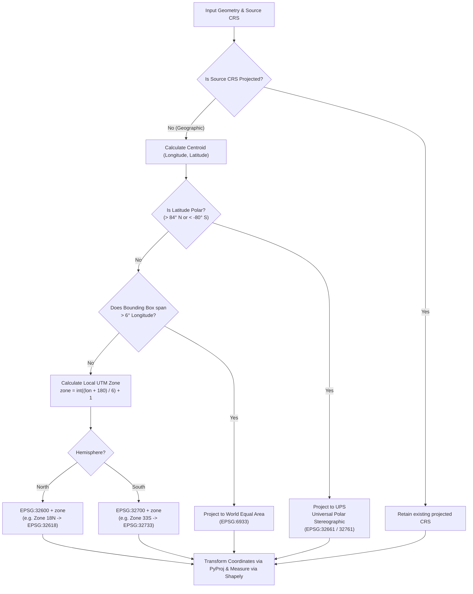
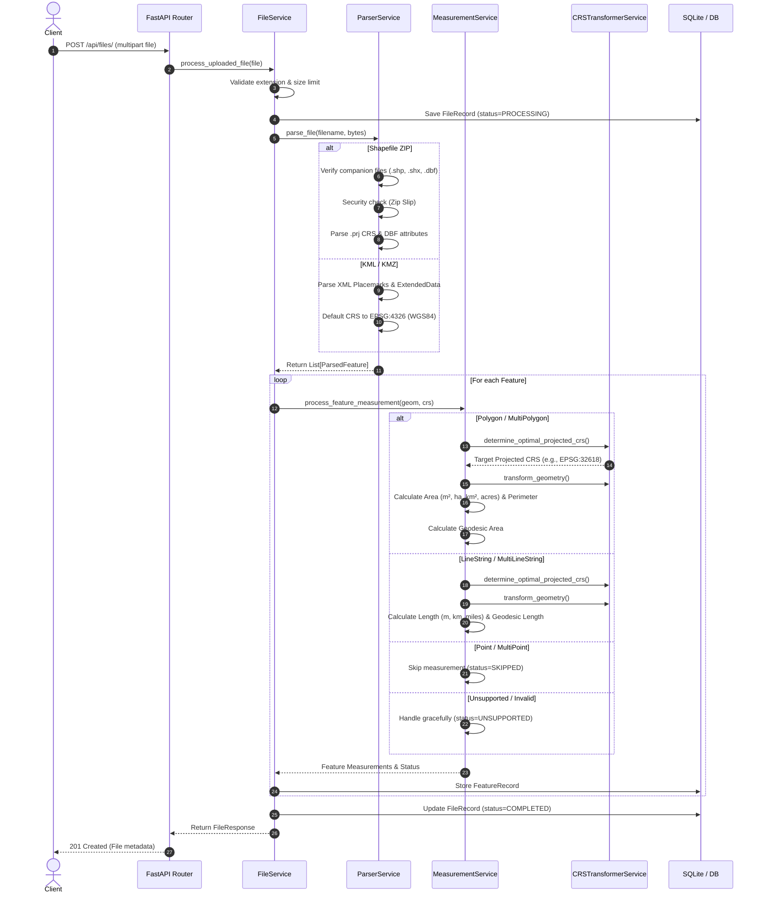

# Geospatial File Measurement API

A production-grade backend service built with **FastAPI**, **Shapely**, and **PyProj** that accepts geospatial files (Shapefiles and KML), extracts their geometric features, and calculates high-precision geometric measurements with intelligent Coordinate Reference System (CRS) reprojection.

---

## Table of Contents

- [Overview](#overview)
- [Key Features](#key-features)
- [Architecture & Application Structure](#architecture--application-structure)
- [CRS Handling & Projection Strategy](#crs-handling--projection-strategy)
- [File Processing & Measurement Flow](#file-processing--measurement-flow)
- [API Reference & Examples](#api-reference--examples)
- [Local Setup & Installation](#local-setup--installation)
- [Running with Docker](#running-with-docker)
- [Running Tests & Test Coverage](#running-tests--test-coverage)
- [Design Decisions & Trade-Offs](#design-decisions--trade-offs)
- [Key Learnings](#key-learnings)
- [Future Scope](#future-scope)

---

## Overview

Geospatial data formats such as **Shapefile (`.zip`)** and **Keyhole Markup Language (`.kml`)** typically store coordinates in angular geographic coordinate reference systems (e.g., `EPSG:4326` WGS 84 in degrees). Calculating Euclidean planar measurements (such as area via Green's theorem or Cartesian distance) directly on geographic coordinates produces distorted and invalid results because 1 degree of longitude narrows substantially away from the equator.

This service solves this challenge by:
1. Ingesting `.zip` archives containing Shapefiles and standard `.kml` (or `.kmz`) files.
2. Dynamically detecting or resolving the source CRS.
3. Automatically determining and projecting geometries into an optimal projected CRS (such as local **Universal Transverse Mercator (UTM)** zones or **World Cylindrical Equal Area**).
4. Performing high-precision geometric measurements (Area for Polygons, Length for LineStrings) in linear metric units (`m²`, `ha`, `km²`, `acres`, `meters`, `kilometers`).
5. Providing **Geodesic** measurements (via Karney's ellipsoidal algorithm in `pyproj.Geod`) alongside projected planar metrics for cross-verification.
6. Handling unsupported, null, or invalid geometries gracefully without crashing.

---

## Key Features

- **Multi-Format Ingestion**: Ingests `.zip` containing Shapefiles (`.shp`, `.shx`, `.dbf`, `.prj`) and `.kml` files.
- **Strict CRS Handling**: Never computes Euclidean measurements on angular degree coordinates; transforms geometries to local projected UTM zones dynamically based on feature centroids.
- **Graceful Geometry Fallback**: Handles Points, MultiPoints, Polygons with interior rings (holes), MultiPolygons, MultiLineStrings, and GeometryCollections gracefully.
- **Fast In-Memory Processing**: Shapefile archives are parsed in memory using `pyshp` without polluting host disk with temporary unzipped files.
- **Path Traversal Security**: Validates ZIP files against Zip Slip vulnerabilities (`..` traversal).
- **Comprehensive API**: REST endpoints for file upload, file metadata inspection, feature measurements with summary statistics, GeoJSON export, and paginated file listings.
- **Interactive Documentation**: Interactive Swagger UI at `/docs` and ReDoc at `/redoc`.
- **High Test Coverage**: 35 automated tests covering all services, transformations, edge cases, and API routes with 90% total test coverage.
- **Container Ready**: Ready-to-deploy multi-stage `Dockerfile` and `docker-compose.yml`.

---

## Architecture & Application Structure

The application is structured following clean architecture principles, separating API routers, domain logic, data models, and services:

```text
assignment_project/
├── app/
│   ├── __init__.py
│   ├── main.py                     # FastAPI application instance, middleware, exception handlers
│   ├── config.py                   # Pydantic BaseSettings (directories, limits, database URL)
│   ├── api/
│   │   ├── __init__.py
│   │   ├── routes.py               # REST endpoints (/api/files/*)
│   │   └── schemas.py              # Pydantic V2 schemas for requests & responses
│   ├── core/
│   │   ├── __init__.py
│   │   ├── exceptions.py           # Domain exceptions (FileUploadError, CRSError, etc.)
│   │   └── crs_transformer.py      # CRS parsing, UTM zone determination & reprojection
│   ├── models/
│   │   ├── __init__.py
│   │   ├── database.py             # SQLAlchemy engine & session factory
│   │   └── db_models.py            # FileRecord and FeatureRecord ORM models
│   └── services/
│       ├── __init__.py
│       ├── file_service.py         # File ingestion orchestration & persistence
│       ├── parser_service.py       # Shapefile & KML parser with security checks
│       └── measurement_service.py  # Area/length calculations & summary aggregation
├── sample_data/
│   ├── generate_samples.py         # Automated generator for test Shapefiles and KMLs
│   ├── sample_polygons.zip         # Shapefile ZIP with NYC park polygons (EPSG:4326)
│   ├── sample_lines.zip            # Shapefile ZIP with street corridors (EPSG:4326)
│   ├── sample_points.zip           # Shapefile ZIP with transit stations (EPSG:4326)
│   ├── sample_survey.kml           # KML with mixed features and ExtendedData
│   └── sample_donut.kml            # KML polygon with inner boundary hole
├── tests/
│   ├── __init__.py
│   ├── conftest.py                 # Pytest fixtures, TestClient, in-memory SQLite DB
│   ├── test_api.py                 # Full integration test suite for all endpoints
│   ├── test_crs_transformer.py     # Unit tests for UTM selection, polar fallbacks, projections
│   ├── test_measurement_service.py # Unit tests for measurements and edge cases
│   ├── test_parser_service.py      # Unit tests for shapefile/KML parsing & security
│   └── test_additional_coverage.py # MultiGeometry, KMZ, and coverage edge cases
├── Dockerfile                      # Production container image
├── docker-compose.yml              # Multi-container orchestration
├── requirements.txt                # Python dependencies
├── .gitignore                      # Git ignore rules
└── README.md                       # Project documentation
```

---

## CRS Handling & Projection Strategy

### The Problem
Latitude and longitude (`EPSG:4326`) are spherical angular coordinates measured in degrees. Calculating Euclidean area via planar formulas on degrees yields meaningless numbers (`deg²`) because 1 degree of longitude is ~111.32 km at the equator, but shrinks to ~85.39 km at 40° latitude and 0 km at the poles.

### Projection Selection Strategy
The application implements an automated CRS selection hierarchy in `app/core/crs_transformer.py`:



1. **Pre-projected CRS**: If the source file already contains a projected coordinate system (e.g. State Plane or predefined UTM), the coordinates are already linear meters and are measured directly.
2. **Local UTM Zones (Standard Case)**:
   - Centroid longitude is mapped to one of 60 standard UTM longitudinal zones:
     $$\text{zone} = \left\lfloor\frac{\text{lon} + 180}{6}\right\rfloor + 1$$
   - Northern hemisphere ($\text{lat} \ge 0$) maps to `EPSG:32601` - `EPSG:32660`.
   - Southern hemisphere ($\text{lat} < 0$) maps to `EPSG:32701` - `EPSG:32760`.
   - UTM preserves conformal shape and yields distance/area scale distortions under 0.1% inside the zone.
3. **Polar Fallback**:
   - Above $84^\circ\text{N}$, UTM is undefined; the service falls back to **Universal Polar Stereographic (UPS) North (`EPSG:32661`)**.
   - Below $-80^\circ\text{S}$, the service falls back to **UPS South (`EPSG:32761`)**.
4. **Wide-Span Features**:
   - Geometries with a longitude span $> 6^\circ$ cross UTM boundaries; the service falls back to **World Cylindrical Equal Area (`EPSG:6933`)** to preserve area fidelity.
5. **Geodesic Cross-Verification**:
   - In addition to planar projected area and length, the service computes **Geodesic** area and length on the WGS 84 ellipsoid via `pyproj.Geod` (solving Karney's geodesic inverse problem), returning both for maximum analytical transparency.

---

## File Processing & Measurement Flow



---

## API Reference & Examples

Interactive API documentation with live execution is available at:
- **Swagger UI**: `http://localhost:8000/docs`
- **ReDoc**: `http://localhost:8000/redoc`

### 1. Upload File
`POST /api/files/`

**Request:**
- Content-Type: `multipart/form-data`
- Body: `file` (`.zip` Shapefile or `.kml`)

**Example `curl`:**
```bash
curl -X POST "http://localhost:8000/api/files/" \
  -F "file=@sample_data/sample_survey.kml"
```

**Response (`201 Created`):**
```json
{
  "id": "e305e9bdc43a",
  "filename": "sample_survey.kml",
  "file_type": "kml",
  "file_size_bytes": 1475,
  "feature_count": 3,
  "crs": "EPSG:4326",
  "status": "COMPLETED",
  "error_message": null,
  "created_at": "2026-10-08T08:15:30.123456+00:00",
  "processed_at": "2026-10-08T08:15:30.245678+00:00"
}
```

---

### 2. Get File Information
`GET /api/files/{id}/`

**Example `curl`:**
```bash
curl -X GET "http://localhost:8000/api/files/e305e9bdc43a/"
```

**Response (`200 OK`):**
```json
{
  "id": "e305e9bdc43a",
  "filename": "sample_survey.kml",
  "file_type": "kml",
  "file_size_bytes": 1475,
  "feature_count": 3,
  "crs": "EPSG:4326",
  "status": "COMPLETED",
  "error_message": null,
  "created_at": "2026-10-08T08:15:30.123456+00:00",
  "processed_at": "2026-10-08T08:15:30.245678+00:00"
}
```

---

### 3. Get Measurements
`GET /api/files/{id}/measurements/`

**Example `curl`:**
```bash
curl -X GET "http://localhost:8000/api/files/e305e9bdc43a/measurements/"
```

**Response (`200 OK`):**
```json
{
  "file_id": "e305e9bdc43a",
  "filename": "sample_survey.kml",
  "file_type": "kml",
  "source_crs": "EPSG:4326",
  "status": "COMPLETED",
  "total_features": 3,
  "summary": {
    "total_features": 3,
    "polygons_count": 1,
    "total_area_sq_meters": 17871.85,
    "total_area_hectares": 1.7872,
    "total_area_sq_km": 0.017872,
    "linestrings_count": 1,
    "total_length_meters": 1435.53,
    "total_length_km": 1.4355,
    "points_count": 1,
    "unsupported_count": 0,
    "errors_count": 0
  },
  "features": [
    {
      "feature_id": 0,
      "geometry_type": "Polygon",
      "geometry": {
        "type": "Polygon",
        "coordinates": [
          [[-73.9835, 40.7538], [-73.9818, 40.7548], [-73.9828, 40.7558], [-73.9845, 40.7547], [-73.9835, 40.7538]]
        ]
      },
      "properties": {
        "name": "Bryant Park",
        "description": "Public park located in Midtown Manhattan",
        "type": "Park",
        "established": "1847"
      },
      "source_crs": "EPSG:4326",
      "projected_crs": "EPSG:32618",
      "projection_method": "UTM Zone 18N (EPSG:32618)",
      "measurements": {
        "area_sq_meters": 17871.85,
        "area_hectares": 1.7872,
        "area_sq_km": 0.017872,
        "area_acres": 4.4162,
        "perimeter_meters": 542.13,
        "geodesic_area_sq_meters": 17870.24
      },
      "status": "MEASURED",
      "notes": null
    },
    {
      "feature_id": 1,
      "geometry_type": "LineString",
      "geometry": {
        "type": "LineString",
        "coordinates": [
          [-74.0078, 40.7395], [-74.0065, 40.742], [-74.0048, 40.746], [-74.002, 40.751]
        ]
      },
      "properties": {
        "name": "High Line Trail",
        "description": "Elevated linear park trail",
        "surface": "Paved"
      },
      "source_crs": "EPSG:4326",
      "projected_crs": "EPSG:32618",
      "projection_method": "UTM Zone 18N (EPSG:32618)",
      "measurements": {
        "length_meters": 1435.53,
        "length_km": 1.4355,
        "length_miles": 0.892,
        "geodesic_length_meters": 1435.49
      },
      "status": "MEASURED",
      "notes": null
    },
    {
      "feature_id": 2,
      "geometry_type": "Point",
      "geometry": {
        "type": "Point",
        "coordinates": [-73.985656, 40.748441]
      },
      "properties": {
        "name": "Empire State Building",
        "description": "102-story Art Deco skyscraper"
      },
      "source_crs": "EPSG:4326",
      "projected_crs": "EPSG:4326",
      "projection_method": "No transformation needed for Point geometry",
      "measurements": {},
      "status": "SKIPPED",
      "notes": "No measurement required for Point geometry per specification."
    }
  ]
}
```

---

### 4. List Files (Paginated)
`GET /api/files/?skip=0&limit=50`

Returns a list of all uploaded files with pagination metadata (`total`, `skip`, `limit`, `items`).

---

### 5. Export as GeoJSON FeatureCollection
`GET /api/files/{id}/geojson/`

Returns all features enriched with properties, measurement metrics, and projection metadata formatted as a standard RFC 7946 GeoJSON `FeatureCollection` suitable for direct rendering on Mapbox, Leaflet, or QGIS.

---

### 6. Delete File
`DELETE /api/files/{id}/`

Deletes the file metadata, database records, and uploaded artifacts on disk.

---

## Local Setup & Installation

### Prerequisites
- Python 3.10+ (Tested on Python 3.11)
- `pip`

### Step-by-Step Setup

1. **Clone the Repository**:
   ```bash
   git clone https://github.com/your-username/geospatial-measurement-api.git
   cd geospatial-measurement-api
   ```

2. **Create and Activate a Virtual Environment**:
   ```bash
   python -m venv venv
   # On Linux/macOS:
   source venv/bin/activate
   # On Windows:
   venv\Scripts\activate
   ```

3. **Install Dependencies**:
   ```bash
   pip install -r requirements.txt
   ```

4. **Generate Sample Data (Optional)**:
   ```bash
   python sample_data/generate_samples.py
   ```

5. **Start the Development Server**:
   ```bash
   uvicorn app.main:app --reload --host 0.0.0.0 --port 8000
   ```

6. **Access Interactive Docs**:
   - Open your browser to [http://localhost:8000/docs](http://localhost:8000/docs).

---

## Running with Docker

You can run the service without any local Python or GDAL installation using Docker and Docker Compose.

1. **Build and Run with Docker Compose**:
   ```bash
   docker-compose up --build
   ```

2. **Run in Detached Mode**:
   ```bash
   docker-compose up -d
   ```

3. **Verify Health Endpoint**:
   ```bash
   curl http://localhost:8000/health
   ```

4. **Stop the Container**:
   ```bash
   docker-compose down
   ```

---

## Running Tests & Test Coverage

The test suite contains **35 tests** covering unit, integration, and security scenarios.

```bash
# Run all tests
pytest -v

# Run tests with coverage report
pytest --cov=app --cov-report=term-missing tests/
```

### Test Coverage Summary:
```text
Name                                  Stmts   Miss  Cover   Missing
-------------------------------------------------------------------
app\api\routes.py                        39      0   100%
app\api\schemas.py                       55      0   100%
app\config.py                            17      0   100%
app\core\crs_transformer.py              71      8    89%
app\core\exceptions.py                   17      0   100%
app\main.py                              27      0   100%
app\models\database.py                   11      0   100%
app\models\db_models.py                  39      0   100%
app\services\file_service.py             83      9    89%
app\services\measurement_service.py      92     12    87%
app\services\parser_service.py          226     37    84%
-------------------------------------------------------------------
TOTAL                                   677     66    90%
============================= 35 passed in 2.71s ==============================
```

---

## Design Decisions & Trade-Offs

| Decision | Rationale | Alternatives Considered |
|---|---|---|
| **FastAPI Framework** | Async I/O, automatic OpenAPI docs, Pydantic V2 type validation, and minimal overhead. | **Django + DRF**: Heavier footprint and boilerplate; FastAPI provides cleaner microservice architecture. |
| **PyShp (`pyshp`) for Shapefiles** | 100% pure Python with zero native C GDAL bindings required on the host system. Enables instant installation and runs seamlessly in lightweight containers. | **GDAL / Fiona**: Often requires complex C/C++ compilation or platform-specific wheel builds, complicating local installs on Windows and slim Docker containers. |
| **Vectorized `shapely.transform`** | Modern Shapely 2.0+ vectorized coordinate transformation eliminates deprecation warnings and executes coordinate re-mapping in C speed. | **`shapely.ops.transform`**: Deprecated in Shapely 2.0+ with higher Python call overhead. |
| **Dynamic UTM Auto-Projection** | Conformal projection minimizing area distortion (<0.1%) within each 6° zone. Ideal for engineering, municipal, and survey data. | **Web Mercator (EPSG:3857)**: Extreme area exaggeration at higher latitudes. **EPSG:4326 Euclidean**: Mathematically invalid. |
| **Dual Projected + Geodesic Calculation** | Provides both local projected metrics and ellipsoidal Karney geodesic metrics for cross-verification. | **Projected only**: Leaves users wondering how projection scale distortion affected their measurements. |
| **In-Memory Zip Extraction** | Prevents disk I/O bottlenecks and eliminates orphaned temporary files on the server host. | **Disk extraction**: Risk of temp file leakage, permission errors, and Zip Slip exploits. |
| **SQLite + SQLAlchemy ORM** | Zero external database setup needed for instant local onboarding and automated testing. | **PostgreSQL + PostGIS**: Excellent for production scale, but adds external infrastructure requirements for reviewers running the code locally. |

---

## Key Learnings

1. **CRS Scale Distortion Nuance**:
   Projecting coordinates to a Cartesian coordinate system inherently introduces some map projection distortion (Tissot's indicatrix). Selecting the centroid's local UTM zone reduces area distortion to $<0.1\%$, whereas applying Web Mercator (`EPSG:3857`) can exaggerate area by more than $70\%$ in temperate latitudes like New York ($40.7^\circ\text{N}$).
2. **KML Namespace Stripping**:
   KML standard documents frequently vary between OGC KML 2.2 (`http://www.opengis.net/kml/2.2`) and Google Earth extensions (`http://earth.google.com/kml/2.1`). Stripping the namespace at the XML ElementTree level guarantees uniform XPath resolution without fragile multi-namespace conditionals.
3. **Geometry Validation & Healing**:
   Real-world geospatial files frequently contain self-intersecting polygons (bowties) or unclosed rings. Running `shapely.validation.make_valid()` ensures valid topology before attempting projection or measurement.

---

## Future Scope

1. **Celery / Redis Background Worker Queue**:
   For gigabyte-sized files (e.g. multi-gigabyte LIDAR or national cadastral shapefiles), move processing from the request cycle to an asynchronous Celery task with real-time WebSocket progress reporting.
2. **PostgreSQL / PostGIS Integration**:
   Add support for storing spatial features directly in PostGIS tables (`GEOMETRY(Polygon, 4326)`) enabling spatial indexing (`GIST`) and spatial SQL queries (`ST_Contains`, `ST_Intersects`).
3. **Raster & Cloud-Optimized GeoTIFF (COG) Support**:
   Expand beyond vector files to support elevation models, surface area calculations, and zonal statistics on raster GeoTIFF files.
4. **Interactive Map UI**:
   Build a companion frontend using MapLibre GL JS or Leaflet to visualize uploaded shapes, colored by area/length with click-to-inspect measurement popups.
5. **Format Expansion**:
   Add direct support for GeoJSON, GeoPackage (`.gpkg`), DXF (CAD files), and TopoJSON.
